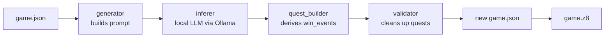
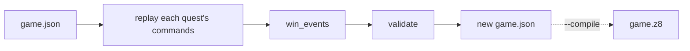
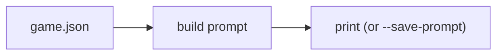
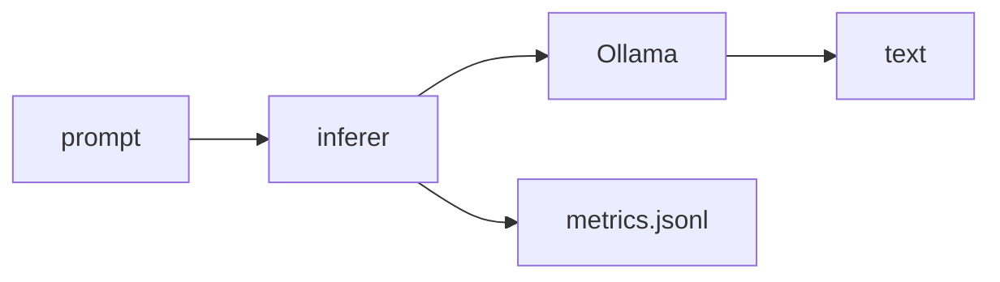

# LlmTextWorld

Generate new quests for [TextWorld](https://github.com/microsoft/TextWorld) games with a **local LLM**
(served by [Ollama](https://ollama.com)), then make sure they are real, playable and non-redundant.

TextWorld games are described by a JSON file (world facts, entities, quests, knowledge base). This project
reads that file, asks an LLM to invent additional quests for the world it describes, turns the answer into
proper TextWorld quests (including the mandatory `win_events`), validates them with TextWorld's own logic
engine, and can recompile the playable `.z8` game.

Everything lives in [`src/quest-generator/`](src/quest-generator).

## How it works



| File | Role |
|---|---|
| `generator.py` | Entry point. Builds the LLM prompt from the game JSON, parses the answer, orchestrates every mode. |
| `entity_types.json` | Editable meaning of entity types (`r` room, `c` container, `k` key…) and wording of predicates. |
| `inferer.py` | Streams a generation from a local Ollama model and records metrics. |
| `metrics.py` | Latency, time to first token, tokens/s, CPU / RAM / GPU sampling, appended to `metrics.jsonl`. |
| `quest_builder.py` | Replays commands with TextWorld's logic engine to derive `win_events`; rebuilds `objective` and `metadata.walkthrough`. |
| `validator.py` | `validate()`: schema, achievability, `win_events` soundness, duplicates. Also a standalone CLI. |
| `planner.py` | Reachability proof + bounded plan search used by the validator to explain impossible quests. |
| `game_compiler.py` | Compiles the JSON to a playable `.z8` (and `.ni`) game. |
| `config.py` / `logs.py` | `.env` loading and per-run log files. |

### Settings precedence

`CLI flag` > `environment variable` > `.env file` > `default`. Copy
[`.env.example`](src/quest-generator/.env.example) to `.env` to configure the model, sampling options,
metrics, logging and validation.

## Modes

> TextWorld-dependent steps (building `win_events`, validating, compiling) need the `textworld` package.
> Run the scripts with the Python of the environment where TextWorld is installed.

### 1. Generate quests with an LLM (default)


```bash
python generator.py game.json --model llama3.2 --num-quests 3
python generator.py game.json --model llama3.2 --num-quests 3 --output out.json --compile
python generator.py game.json --model llama3.2 --replace-quests      # replace instead of append
```

New quests are appended to the existing ones (the originals are never modified). The result is written to
`<game>.generated.json` unless `--output` is given.

### 2. Fill `win_events` only (no LLM)

For quests that already have `commands` (hand-written or edited) but empty `win_events`.



```bash
python generator.py game.json --fill-win-events --output out.json
python generator.py game.json --fill-win-events --overwrite --compile --output game.json
```

Quests with impossible commands are left untouched and reported (exit code 1).

### 3. Only look at the prompt



```bash
python generator.py game.json --prompt-only --num-quests 2
```

### 4. Validate a game file


`validate()` runs automatically at the end of the modes above. It is **on by default**; disable it with
`--skip-validations` (or `SKIP_VALIDATIONS=true`).

| Check | What it catches |
|---|---|
| Schema | Missing keys, malformed quests, unknown entities, empty `win_events`. |
| Achievability | Quests that can't be played from the initial state. The planner explains why: *provably unreachable* (e.g. a room behind an unreachable room) vs. *goal achievable but commands wrong* vs. *no plan within budget*. |
| `win_events` soundness | Actions that aren't valid rule instances, commands that don't match the actions, a win condition already true at the start, fail events triggered on the way. |
| Duplicates | New quests repeating a pre-existing or another new quest, mere fragments of one, or sharing a goal with one. |
| Joint winnability | The game as a whole must have a playthrough completing every quest (warning only). |

Pre-existing quests are **never removed**, only reported. New defective quests are removed. Everything found is
logged as a warning in the run's log file.

```bash
python validator.py game.json                                    # report only
python validator.py out.json --baseline game.json --output clean.json
python validator.py out.json --baseline game.json --plan-budget 20000
```

### 5. Compile the playable game

The `.z8` embeds the quests, so it must be rebuilt after the quests change. Without `--compile`:


```bash
python game_compiler.py game.json
python game_compiler.py game.json --output other.z8
```

Compilation refuses games with quests that have no `win_events`.

### 6. Query the model directly



```bash
python inferer.py --model llama3.2 --prompt "Say hi"
python inferer.py --model llama3.2 --prompt-file prompt.txt --json --temperature 0.2
```

## Setup

```bash
# Developed and tested with Python 3.14; needs TextWorld installed and a running Ollama server
pip install textworld psutil
ollama pull llama3.2
cp src/quest-generator/.env.example src/quest-generator/.env     # then edit
cd src/quest-generator
python generator.py game.json --model llama3.2 --num-quests 2 --compile
```

Optional: `pynvml` (or `nvidia-smi` on the PATH) enables GPU metrics.

## Logs and metrics

- **Per-run log:** every run writes `logs/<timestamp>_<script>.log` with full DEBUG detail: settings, the
  prompt, the model's **raw response before any processing**, why quests were dropped, validation warnings.
  The console shows INFO and above (`--log-level`, `--log-dir`).
- **Metrics:** each inference appends one JSON line to `metrics.jsonl`: latency, time to first token,
  generation time, tokens/s, CPU / RAM / GPU usage (average and peak) and model VRAM.

## Useful options

| Option | Env variable | Meaning |
|---|---|---|
| `--model` | `OLLAMA_MODEL` | Ollama model tag. |
| `--host` | `OLLAMA_HOST` | Ollama server URL. |
| `--temperature`, `--top-p`, `--top-k`, `--seed`, `--num-ctx`, `--max-tokens`, `--think` | `OLLAMA_*` | Generation options. |
| `--num-quests` | – | How many quests to ask for. |
| `--keep-objective` | – | Don't rebuild `objective` / `metadata.walkthrough` from the quests. |
| `--skip-validations` | `SKIP_VALIDATIONS` | Turn the final validation off. |
| `--plan-budget` | `VALIDATION_PLAN_BUDGET` | States the planner may expand per suspicious quest. |
| `--env-file` | – | Use a specific `.env`. |

Run any script with `--help` for the full list.

## Limitations

- Quests must be completable from the game's initial state.
- `reward`, `fail_events`, `optional` and `repeatable` of generated quests use fixed defaults.
- The in-game objective is TextWorld's own step-by-step phrasing, not the LLM-written `desc`.
- Only Ollama is supported as an inference backend.
